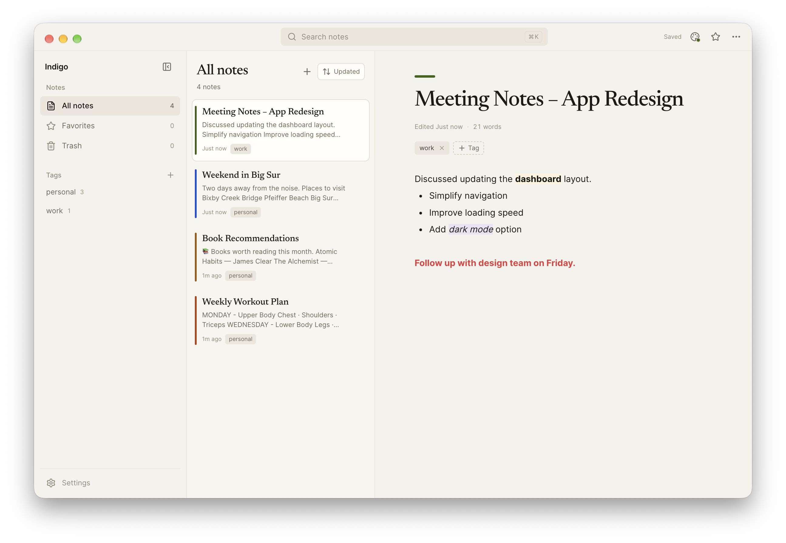

# Indigo

<p align="center">
  
</p>

> A quiet, local-first notes workspace with a block editor, tags, and a paper-and-ink shell.

## Features

- **A real writing surface.** Notes use BlockNote's block editor, with headings, lists, checklists, quotes, code blocks, and tables.
- **Tags instead of folders.** Create a tag once, reuse it everywhere, rename it in place, and filter the library by any tag.
- **Local files, not a database.** Every note is a JSON file inside Indigo's own notes folder. There is no account, server, or sync service.
- **A calm shell.** Warm paper surfaces, serif note titles, a sidebar that folds into an icon rail, a search-first title bar, and custom window controls.
- **Light, dark, and system themes.** Per-note colours mark notes in the list and above the title without recolouring the whole app.
- **Autosave that waits for the write.** Writes are atomic and queued; closing a note, switching views, quitting, or closing the window waits for pending edits. If saving fails, the editor stays open with a retry action instead of navigating away from unsaved work.
- **Titles from your writing.** A note written without a title takes its opening words as the title when possible. Indigo only discards an empty draft that it created and that still has no content.
- **Pin what matters.** Pinned notes stay at the top of the list under their own heading, survive sorting, and are duplicated unpinned.
- **Tasks across your library.** Every checklist item in every note shows up in a single Tasks view; tick one there and the note itself is updated on disk. Open items come first, finished ones sink below a done heading.
- **Export as Markdown.** Turn any note into a `.md` file with ⌘⇧E or the note menu; Indigo converts headings, lists, checklists, quotes, code blocks, and tables, and saves it to your Downloads folder.
- **Focus mode.** The Focus button in the note toolbar takes the title bar, sidebar, and notes list away so the page is the whole window. A quiet Exit focus button in the corner or Escape brings everything back.
- **Trash with a safety net.** Move notes to trash, restore them, or delete them permanently after a confirmation.
- **Updates from GitHub.** Indigo checks for a newer release on launch, installs it in place on macOS, Windows, and Linux AppImage builds, and restarts without touching your notes.
- **A reset you can reason about.** Soft reset clears the interface. Hard reset removes only the notes Indigo recognizes, its tags, and its settings; unknown files and backups are left alone.

## Installation Guide

### macOS (.dmg)

Indigo is not signed with an Apple Developer certificate, so macOS may block it the first time.

1. Download the `.dmg` for your Mac: **Apple Silicon** for M-series chips or **Intel** for older Macs.
2. Open the downloaded file and drag **Indigo** into **Applications**.
3. Open **Terminal** and run:

    ```bash
    xattr -cr /Applications/Indigo.app
    ```

4. Open Indigo from Applications. This is a one-time step.

### Windows (.exe)

The installer is not code-signed, so Windows SmartScreen may show a warning.

1. Download the `.exe` installer.
2. Run the installer.
3. If **Windows protected your PC** appears, choose **More info**, then **Run anyway**.
4. Finish the installation wizard.

### Linux (.AppImage)

1. Download the `.AppImage` for **x64** or **ARM64**.
2. Make it executable: right-click → **Properties** → **Permissions** → **Allow executing file as program**.
3. Double-click the file to run it.

## Your data

Indigo keeps everything in one visible folder in your home directory: `~/.indigo`.

```
~/.indigo
├── config.json   theme and window state
└── notes         one JSON file per note
```

The exact path for the current machine is shown in **Settings → Library**, and **Open folder** reveals it in your file manager.

- Notes live in `~/.indigo/notes`. Tags are kept in `~/.indigo/notes/_tags.json`.
- Writes are atomic, and files are never sent anywhere.
- Deleting the notes folder or using **Settings → Reset → Delete everything** removes every note, tag, and setting.
- Builds before this one kept notes and settings inside the system application-data folder. On first launch Indigo copies those files into `~/.indigo` and leaves the originals in place.
- Older Indigo versions stored notes in a `.indigo` SQLite database. That format is not imported automatically and those files are left untouched. Export anything you need from an older build before switching.

## Data safety

Indigo is a local-first app, so the files on disk are the source of truth. These are the rules it follows:

- **Writes are durable and atomic.** A note is written to a temporary file, flushed to disk, renamed over the old file, and the folder is synced. A crash or power loss cannot leave a half-written note behind.
- **Autosave is short.** Changes are written about 250 ms after you stop typing. The editor also flushes when the window loses focus or becomes hidden.
- **Leaving waits for the save.** Switching notes, closing a note, changing views or tags, duplicating, moving to trash, and restoring all save first. If that save fails, the action is cancelled, the editor stays open, and the title bar shows **Save failed · Retry**.
- **Quitting and closing wait too.** Indigo asks the editor to finish saving before quitting or closing the window. It waits up to two seconds, then asks whether to continue if the save could not be confirmed. An update installs only after that handshake succeeds.
- **Drafts are removed only when they are provably empty.** A draft must have been created by Indigo, still carry its draft marker, and contain no title, text, table, image, media, or code. Unknown JSON, malformed files, backups, renamed files, and legacy empty notes are never pruned.
- **The tags file is protected.** If `_tags.json` is corrupt, Indigo writes the original bytes to a `_tags.corrupt-*.json` backup and rebuilds the list from the tags still named by notes. If the file cannot be read at all, tag operations fail rather than overwriting it.
- **Skipped files are visible.** **Settings → Library → Storage health** lists any files Indigo could not read as notes. They are left untouched, and **Open folder** takes you to them.
- **Hard reset is bounded.** **Delete everything** removes only recognized note files, `_tags.json`, and settings. Unknown files, malformed notes, and backups stay in the folder.

There is no cloud copy, so keep your own backup of `~/.indigo` if the writing matters. Copying the folder while Indigo is closed is enough; every file is plain JSON.

## Updates

Indigo checks GitHub for a newer release each time it opens. When one is available, a small notice appears in the corner with a link to the release notes and a download button.

On macOS, Windows, and Linux AppImage builds, Indigo downloads the matching build, verifies its SHA-256 checksum when GitHub provides one, closes, installs the update in place, and opens again. Indigo asks the editor to finish saving before it closes; if that save cannot be confirmed, it warns before quitting. Notes in `~/.indigo` are never touched.

Indigo falls back to the release page when it cannot replace itself, including development builds, macOS builds running from a mounted disk image, Linux builds not started from an AppImage, and installs in folders it cannot write to. Settings → Updates shows the current version and the same download and release-page actions.

The check uses the public GitHub Releases API. It sends the app version in the request header and never sends note contents.

## Development

Requirements: Node.js 24 or newer.

```bash
npm ci
npm run dev
```

Useful checks:

```bash
npm run typecheck
npm run lint
npm test
npm run build
npm run test:e2e   # builds the app, then launches Electron
```

The end-to-end suite writes into a temporary folder selected with `INDIGO_DATA_DIR`, so it never touches your real `~/.indigo`. On Linux it needs a display; CI runs it under `xvfb-run`.

The lockfile is committed, so CI uses `npm ci` and builds the same dependency tree you test locally. Pull requests run typecheck, lint, unit tests, build, and the Electron end-to-end suite. `main` only accepts changes through pull requests, and every merge runs the same checks again before packaging.

## Releases

`main` only accepts merged pull requests, and every merge publishes a release. Before opening the pull request that should ship:

1. Bump `version` in `package.json` (for example `1.0.8` to `1.0.9`) and commit it with the rest of the change.
2. Open the pull request, wait for the `verify-indigo` checks, and merge.

The `release-indigo` workflow then runs on `main` and:

- repeats typecheck, lint, unit tests, build, and the Electron end-to-end suite,
- fails with a clear error if the `v<version>` tag already exists, so a missing version bump cannot silently republish a release,
- builds macOS (Apple Silicon and Intel), Windows, and Linux (x64 and ARM64) artifacts,
- publishes them as a draft-free GitHub release on the merge commit.

If a run fails after packaging, use **Re-run failed jobs** on the workflow run instead of merging again. To ship a different version, follow the same steps with a new version in `package.json`.
